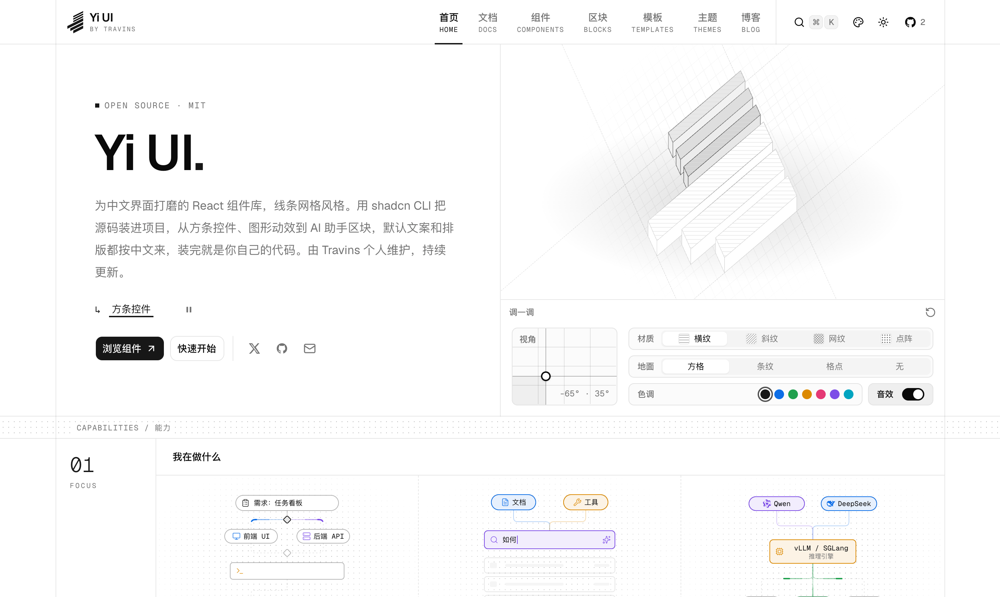
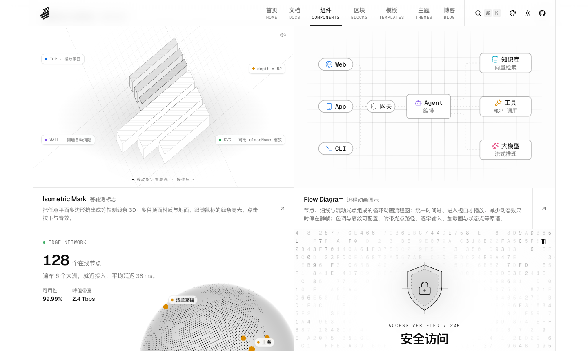

<div align="center">

<a href="https://yiui.dev">
  
</a>

<h1>Yi UI</h1>

<p><strong>易</strong> · 线条网格风格的 React 组件库：源码直接装进你的项目，装完就是你自己的代码。</p>

<p>
  <a href="https://yiui.dev">官网</a> ·
  <a href="https://yiui.dev/components/">组件</a> ·
  <a href="https://yiui.dev/blocks/">区块</a> ·
  <a href="https://yiui.dev/templates/">模板</a> ·
  <a href="https://yiui.dev/themes/">主题</a> ·
  <a href="https://yiui.dev/docs/installation/">文档</a>
</p>

<p><strong>简体中文</strong> · <a href="./README.en.md">English</a></p>

</div>

<picture>
  <source media="(prefers-color-scheme: dark)" srcset=".github/assets/preview-dark.png" />
  
</picture>

## 简介

Yi UI 是一个以 **shadcn registry** 形式发布的组件库，由 Travins 个人维护，官网是 [yiui.dev](https://yiui.dev)。组件不打成 npm 包，而是用 shadcn CLI 把源码复制进你的项目，样式、结构、交互都可以直接改。

名字取自站点标志「易」（三道细斜杠是「日」，三道粗斜杠是「勿」）：既是「容易上手」，也是「随你改动」。

Yi UI 面向**中文产品**：文档用简体中文写，组件的默认文案（按钮、提示、读屏标签）是中文，排版按中文系统字体栈调过，装进中文项目基本不用再改文案。

视觉上统一使用「线条网格」语言：全宽横线、竖线容器、点阵分隔带，配合细边框、小圆角与克制的动效。

## 特点

- **源码归你** —— 通过 shadcn CLI 安装，组件、依赖的其他条目、需要的 CSS 变量会一并写入项目。
- **Base UI 底座** —— 交互原语基于 [Base UI](https://base-ui.com)，键盘操作、焦点管理与读屏语义开箱即用。
- **跟随主题** —— 所有颜色都取自主题变量：亮 / 暗模式加 14 套颜色主题，切换时组件自动变色。
- **方条控件系列** —— 数值滑块、分段选择、开关、色调、角度、二维拖拽板共用一套高度与外观，可以拼成参数面板，并一键把当前参数复制为 JSX；金额、手机号、证件号、数量、省市区这些中文表单控件也用同一套外观。
- **手机上好用** —— 触屏设备上按钮与输入框自动加高一档（36 / 40 / 44px），拖拽类控件能区分滚动和拖动，数字输入调起数字键盘；每个示例都能扫码在手机上单独打开体验。
- **动效有分寸** —— 进入视口才播放、离屏自动暂停、尊重「减少动态效果」。
- **预渲染友好** —— 页面在构建时全部预渲染；依赖测量或画布的组件在脚本加载前渲染同尺寸占位，不会出现空白或布局跳动。
- **对 AI 友好** —— 每篇文档都有 Markdown 版本，并提供 [`llms.txt`](https://yiui.dev/llms.txt) 与 [`llms-full.txt`](https://yiui.dev/llms-full.txt)。

## 快速开始

需要 React 19、Tailwind CSS v4，以及选择了 **Base UI** 底座的 shadcn 项目。

```bash
# 新建项目（已有项目去掉 -t / -n 两个参数）
pnpm dlx shadcn@latest init -t next -b base -p nova -n my-app

# 用完整地址安装任意组件
pnpm dlx shadcn@latest add https://yiui.dev/r/value-slider.json
```

想用更短的命令，在 `components.json` 里登记命名空间：

```json
{
  "registries": {
    "@yiui": "https://yiui.dev/r/{name}.json"
  }
}
```

```bash
pnpm dlx shadcn@latest add @yiui/value-slider
```

完整说明（文件落点、依赖、样式写入与常见问题）见[安装文档](https://yiui.dev/docs/installation/)。

## 组件

<picture>
  <source media="(prefers-color-scheme: dark)" srcset=".github/assets/components-dark.png" />
  
</picture>

| 分组 | 组件 |
| --- | --- |
| 图形与动效 | [等轴测标志](https://yiui.dev/components/isometric-mark/) · [流程动画图示](https://yiui.dev/components/flow-diagram/) · [点阵地球](https://yiui.dev/components/globe/) · [字符矩阵](https://yiui.dev/components/glyph-field/) · [动态格](https://yiui.dev/components/shuffle-grid/) · [轨道环绕](https://yiui.dev/components/orbit/) · [波纹脉冲](https://yiui.dev/components/ripple/) · [代码文件堆叠](https://yiui.dev/components/code-stack/) |
| 表单与输入 | [数值滑块](https://yiui.dev/components/value-slider/) · [控制面板](https://yiui.dev/components/control-panel/) · [二维拖拽板](https://yiui.dev/components/xy-pad/) · [角度刻度尺](https://yiui.dev/components/angle-dial/) · [分段选择](https://yiui.dev/components/segmented-control/) · [方条开关](https://yiui.dev/components/toggle-switch/) · [色调选择](https://yiui.dev/components/tone-picker/) · [金额输入](https://yiui.dev/components/amount-input/) · [手机号输入](https://yiui.dev/components/phone-input/) · [证件号输入](https://yiui.dev/components/id-number-input/) · [数量选择](https://yiui.dev/components/number-stepper/) · [步骤条](https://yiui.dev/components/steps/) · [省市区选择](https://yiui.dev/components/region-picker/) · [文件上传](https://yiui.dev/components/file-upload/) |
| 数据展示 | [图表卡片](https://yiui.dev/components/chart-card/) · [统计卡片](https://yiui.dev/components/stat-card/) · [迷你图](https://yiui.dev/components/mini-chart/) |
| 文字与滚动 | [文字动效](https://yiui.dev/components/text-animate/) · [跑马灯](https://yiui.dev/components/marquee/) |
| 内容展示 | [时间线](https://yiui.dev/components/timeline/) · [卡片堆叠](https://yiui.dev/components/card-stack/) · [手写清单](https://yiui.dev/components/checklist/) |
| 时间 | [实时当地时间](https://yiui.dev/components/local-time/) · [时段问候](https://yiui.dev/components/greeting/) |
| 布局 | [线条网格布局](https://yiui.dev/components/grid-layout/) |
| 工具函数 | [中文数字](https://yiui.dev/components/chinese-number/) · [全国行政区划](https://yiui.dev/components/china-regions/) · [色调变量](https://yiui.dev/components/flow-tone/) |

## 区块与模板

| 名称 | 说明 |
| --- | --- |
| [设置页 `settings-01`](https://yiui.dev/blocks/settings-01/) | 用方条控件拼成的完整设置页：分区导航、实时预览、已修改计数、恢复默认与异步保存。 |
| [分屏登录页 `auth-01`](https://yiui.dev/blocks/auth-01/) | 品牌面板加表单：密码 / 验证码登录（手机号自动分隔、条内获取验证码与倒计时）、注册（带强度条）、找回密码。 |
| [AI 助手面板 `agent-chat-01`](https://yiui.dev/blocks/agent-chat-01/) | 嵌入与浮动两种布局，展示分析摘要、工具调用、来源与图表，内置流式演示。 |
| [企业控制台布局 `app-shell-01`](https://yiui.dev/templates/app-shell-01/) | 固定顶栏、可折叠导航、工作区侧栏与 AI 助手，带统计卡与图表的示例页面。 |

## 颜色主题

中性、石色、板岩三套灰阶基底，加红、橙、琥珀、青柠、绿、青绿、天蓝、蓝、紫罗兰、紫红、粉红 11 套彩色主题；彩色主题的按钮一律白字，对比度都在 4.5:1 以上。可以在[主题页](https://yiui.dev/themes/)预览后复制 CSS 变量，或直接安装：

```bash
pnpm dlx shadcn@latest add https://yiui.dev/r/theme-blue.json
```

## 本地开发

```bash
git clone https://github.com/Travins/yi-ui.git
cd yi-ui
nvm use          # Node 24（见 .nvmrc）
pnpm install
pnpm dev
```

| 命令 | 作用 |
| --- | --- |
| `pnpm dev` | 启动开发服务器 |
| `pnpm build` | 生产构建（`pnpm start` 本地预览） |
| `pnpm lint` | 代码检查 |
| `pnpm registry:build` | 生成 `public/r/*.json` 等 registry 产物 |
| `pnpm registry:lint` | 检查 registry 条目的依赖、文件与书写规范 |
| `pnpm qa:shots <组件名>` | 对构建产物截图验收（亮暗、颜色主题、窄屏、报错与溢出） |
| `pnpm qa:install [条目名…]` | 本地安装、类型、构建与浏览器验收；支持 `--fresh`、`--keep`、`--namespace`、`--monorepo` |
| `pnpm qa:interaction` | 交互验收：触屏高度、焦点样式、键盘操作、出错态能否随输入消失等必查项；`--build` 对构建产物检查 |
| `pnpm qa:loading` | 拦截脚本检查加载前的占位与空白 |

## 目录结构

```
content/            文档与博客（MDX）
src/registry/       对外发布的源码（唯一真源）
  ui/               组件
  blocks/           区块
  templates/        页面模板
  examples/         文档里的示例
src/components/     站点自身的外壳、文档渲染、首页
src/styles/         线条网格、颜色主题与文档样式
registry.json       registry 清单
public/r/           构建生成的 registry JSON
```

文档预览、代码展示与 `public/r/*.json` 都读取 `src/registry/` 里的同一份源码。

## 技术栈

[Next.js](https://nextjs.org) 16（App Router，部署在 Vercel）· [React](https://react.dev) 19 · [Tailwind CSS](https://tailwindcss.com) v4 · [shadcn/ui](https://ui.shadcn.com) · [Base UI](https://base-ui.com) · [Motion](https://motion.dev) · [Fumadocs](https://fumadocs.dev)（内容层）· [Shiki](https://shiki.style) · [Recharts](https://recharts.org)

## 参与贡献

欢迎提交 Issue 与 Pull Request，流程与规范见 [CONTRIBUTING.md](./CONTRIBUTING.md)。

## 许可证

[MIT](./LICENSE) © Travins
